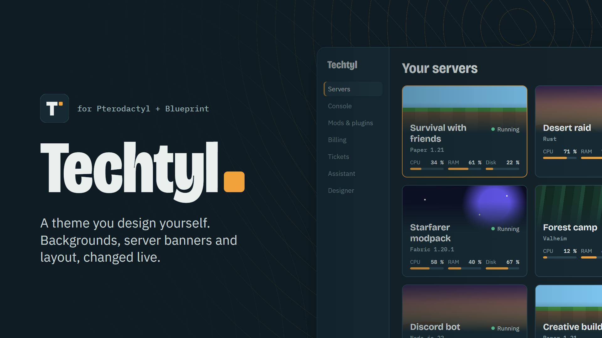

<p align="center">
  
</p>

# Techtyl

Techtyl is an open-source theme and extension for the [Pterodactyl](https://pterodactyl.io) panel, built on [Blueprint](https://blueprint.zip). It restyles the client area, the admin area and the sign-in pages, and it adds a live designer, custom backgrounds, server banners and built-in tools.

The version in this repository is 0.1.0. There is no packaged release yet. The sections below describe what the code does today.

## What Techtyl does

### Design variants and the designer

Four variants ship with the theme: Shipyard (dark teal), Paper (light), Harbour (dark purple) and Pine (dark green). On top of the variant, the design stores an accent colour, a corner radius, how much the interface moves (off, subtle or full), and where the navigation sits: a wide sidebar, a narrow icon rail, or a bar across the top. The server list can be a grid, a row list or a compact list. A background can be dimmed, made partly transparent, or blurred. Changes are written as CSS variables, so they apply without rebuilding the panel.

Root administrators edit the default in a full-page designer at `/extensions/techtyl/designer/editor`, with a live preview of the dashboard, a server console, the sign-in page and the admin area. The same page sets the sign-in title, subtitle and image, an announcement, and a short list of website and social links. It is also where the administrator decides what each user may change: appearance (variant, accent, radius, motion), layout (navigation, server-list layout, banners and their height), background (dim, opacity, blur, and which bundled picture to use), and server banners. The upload limit is set there too. It defaults to 2048 KB and can be anywhere from 64 KB to 10240 KB.

Each user has a design page at `/account/design`. It saves only the groups the administrator has left open. Sign-in text, the announcement and the links stay with the administrator.

### Backgrounds and server banners

Bundled backgrounds and one banner per common egg live in `public/defaults/`, listed in `manifest.json`. A server banner is chosen in this order: the user's own upload, then the banner an administrator uploaded for that egg, then the bundled banner (matched by egg name, then by rules in the manifest, then by nest, otherwise a default). Users may upload a background and a banner only when the administrator allows it. Uploaded files are checked and re-encoded on the server; the original file is not stored. JPEG and WebP need PHP GD support for those formats. The Blueprint Docker image can only handle PNG, so on that image only PNG uploads work. With a full GD build, Techtyl stores the result as WebP.

### Client area and admin area

At install time Techtyl replaces the client navigation, the navigation inside a server, the server list row and the account routes. The server console, file manager and the other stock server pages stay the panel's own screens; the stylesheet restyles them. Servers are shown as cards with their banner, their state and their CPU, memory and disk use in percent. The navigation includes a command palette (Ctrl+K, or Cmd+K) for jumping to pages, sending power signals on the open server, and listing servers from the panel's server API. Folders, a search field on the list itself, and selecting several servers at once are not in the list interface yet: the folder API is there, and the list toolbar component is still empty.

The account area replaces the panel's account pages and adds a profile page and a security page. See Accounts below.

The admin area follows the same variant, accent and background. A Techtyl group is inserted in the admin sidebar, ahead of Management, and is visible to root administrators. It links to the designer, the design settings, the module switches, and each module that is turned on. On the admin home page, root administrators get an overview of panel figures (servers, memory, disk, users and similar counts). Cards can be reordered or hidden, and the administrator can add up to twelve custom cards. Enabled modules can add a tile of their own. In-app error screens (the panel's screen block) are restyled with the same surfaces. The sign-in form is restyled in the client stylesheet.

### Modules

Five modules can be switched on or off under `/admin/extensions/techtyl` on the Modules tab. All of them start off. A module that is off answers 404 on its routes. Its data is kept.

**Tickets.** Users open tickets in the client area. Root administrators read and answer them in the admin tab. Tickets have categories, a status, optional image attachments and mail notifications. A scheduled job closes tickets that have had no user reply for the configured number of days, and it removes orphaned attachments.

**Billing.** Administrators define packages (memory, CPU, disk, databases, backups, allocations, eggs, nodes and locations) with a monthly price and an optional daily price. Users can take a package as a Stripe subscription, billed monthly, or pay the daily price from account credit. Credit is topped up through Stripe Checkout, and an administrator can add or remove credit by hand. After a missed payment the server is suspended, and after a further period it is deleted. The defaults are 3 days until suspension and 14 days until deletion. The panel talks to the Stripe API directly. The webhook is described under Configuration.

**Sign-up and sign-in.** With the module and its registration switch on, new accounts confirm an e-mail link and then set a password. The link expires, works once, and new accounts are never administrators. Optional limits are an invitation code, an allow-list of e-mail domains, and Cloudflare Turnstile on the registration form and, separately, on sign-in. Discord and Google can be used to sign in and can be linked to an existing account. While registration is off, those providers cannot create accounts either. Passwords for accounts created here are hashed with bcrypt at the panel's cost.

**Server tools.** On a server page, when the module is on and the egg is a supported type:

- Plugins and mods from Modrinth. Paper, Purpur, Folia and Velocity are treated as plugin servers. Fabric, Forge and NeoForge are treated as mod servers. The page can search, install, update and remove projects, and it can pull required dependencies. It does not list modpacks. Files are downloaded onto the server through a queued task.
- A version changer for Paper, Folia and Velocity (PaperMC), Purpur, Vanilla (Mojang) and Fabric (game version and loader version). Forge and NeoForge version switching is not built. Those servers can still install mods. The version page tells the user to change the version under Startup and reinstall.

The administrator maps each egg to a type, or leaves the mapping on automatic. The guess uses the egg name, its variables and its features. Players, worlds, a properties editor and a log viewer have pages in the client router, but those pages are placeholders and have no API yet.

**AI assistant.** An account page sends a question, with optional server context, to one configured provider. The providers in the code are Anthropic, OpenAI, Google Gemini, Azure OpenAI, Mistral, Groq, OpenRouter, a custom OpenAI-compatible server (for example Ollama), and a demo provider that answers locally without calling anyone. Keys are stored encrypted. The administrator sets the default provider, models, daily and per-minute limits, and how long conversations are kept. A daily job deletes expired conversations.

### Accounts

The account area is always available. It is not one of the five modules. It replaces the overview, API keys, SSH keys and activity log, and it adds profile and security pages. Users can upload a profile picture when the administrator allows it. Pictures are cropped and re-encoded, and they are shown only to signed-in users, including in the admin user list and the admin top bar, in place of Gravatar. Gravatar as a fallback is off unless an administrator turns it on. Changing one's first and last name is off by default. Usernames stay under the administrator's control. The account language can be set to German. See Languages.

### Bundled eggs

Seven eggs are imported once during installation, from `data/eggs/`. They are not imported again, and an egg of the same name already in the same nest is left as it is. The files are unchanged copies of pelican-eggs, under the MIT licence in that folder. See `data/eggs/HERKUNFT.txt`.

| Egg | Nest |
|---|---|
| Node.js generic, Nodemon, Python generic, Bun, Deno Generic | Generic (created if it does not exist) |
| Fabric, Velocity | Minecraft (created if it does not exist) |

Removing Techtyl does not delete imported eggs. Servers may still be using them.

### Languages

English is the default. German is the other language. The language is the account's panel language when that language is German, otherwise the default chosen on the Modules tab, otherwise English. Sign-in pages and accounts that have not chosen a language use the administrator's default. Installation creates `resources/lang/de` in the panel so the panel will accept German as an account language. Removal sets every account that was set to German back to English, because the panel checks the language against the folders in `resources/lang`.

## Status

| Part | State |
|---|---|
| Design variants and the designer, including per-user changes inside the limits above | Working |
| Backgrounds, egg banners, user uploads and bundled defaults | Working |
| Restyled client area, admin area, sign-in page and in-app error screens | Working |
| Admin overview and the Techtyl sidebar group | Working |
| Account area and profile pictures | Working |
| Tickets | Working |
| Billing with Stripe | Working, but only tested against a stand-in, never against Stripe |
| Sign-up, e-mail confirmation, invitation codes and the domain list | Working |
| Turnstile, Discord and Google | Working, but only tested against stand-ins, never against those services |
| Plugins and mods through Modrinth | Working, tested on a Paper server; the dependency dialog has not been tried with a real dependency |
| Version switching for Paper | Working, tested end to end on a real server |
| Version switching for Purpur, Folia, Velocity, Vanilla and Fabric | Version lists and downloads resolve; the switch itself is not tested on a live server, and Fabric has not been tried at all |
| Version switching for Forge and NeoForge | Not built |
| Players, worlds, properties and logs | In progress |
| Server-list folders, list search and multi-select | In progress |
| AI assistant | Working, but the providers have only been tested against stand-ins, never against the real services. The demo provider answers locally and does not call a service |
| Bundled egg import | Working |
| English and German | Working |

## Requirements

- Pterodactyl Panel 1.15.x
- Blueprint `beta-2026-08` (the `target` in `conf.yml`)
- PHP GD. JPEG and WebP uploads need GD built with those formats. PNG works with the GD in the Blueprint Docker image. Without `imagecreatetruecolor`, uploads are refused.
- The panel's scheduler (cron). Blueprint runs the jobs in `console/Console.yml` as `php artisan techtyl:<signature>`:

  | Command | Interval | What it does |
  |---|---|---|
  | `php artisan techtyl:tickets-autoclose` | hourly | Closes tickets with no user reply and removes orphaned attachments |
  | `php artisan techtyl:auth-cleanup` | hourly | Deletes expired, unconfirmed registrations |
  | `php artisan techtyl:billing-daily` | hourly | Charges the daily price of credit-funded servers, at most once per day and subscription |
  | `php artisan techtyl:billing-enforce` | hourly | Suspends after missed payments, unsuspends after payment, deletes after the deletion period |
  | `php artisan techtyl:assistant-prune` | daily | Deletes expired assistant conversations |

- A queue worker, and working mail settings (`MAIL_*` in the panel environment). Confirmation mails and ticket notifications are queued. If the mailer is one that does not send, nobody can finish registering. Plugin installs and version switches are queued jobs too. With `QUEUE_CONNECTION=sync` they only continue while that server's page stays open.
- For Docker installs, the database tables. `data/install.sh` runs `php artisan migrate --force`. If that step fails, the admin pages say so and the same command has to be run by hand. Blueprint itself does not run migrations on a Docker install.

## How it changes the panel

During installation, `data/patch.php` applies `data/patches.json` and every file in `data/patches/`. Each entry is an exact text replacement in a panel file under `resources/` or `app/`: the client navigation, the server navigation, the server list row, the account routes, the admin user avatars, and the admin sidebar. Originals are stored under `.blueprint/extensions/techtyl/private/.backup`. Removal writes those originals back, then deletes every database table whose name starts with `techtyl_` and deletes uploaded images under `storage/.extensions/techtyl`.

If a panel or Blueprint update changes one of the searched lines, that replacement is skipped and the panel keeps its normal component at that spot. A file that was changed from outside after Techtyl patched it is not overwritten with an older backup.

## Installation

There is no packaged release. On a panel with Blueprint in developer mode, copy this repository into the panel's `.blueprint/dev` directory and build it:

```sh
blueprint -build
```

Try this on a test panel first. The extension replaces pieces of the panel, and it is not ready for a panel that other people depend on.

After a successful build:

- Settings, module switches, the default language and the account switches are at `/admin/extensions/techtyl`.
- The designer is at `/extensions/techtyl/designer/editor` (root administrators, with the same two-factor requirement as the admin area). Opening `/extensions/techtyl/designer/` follows the redirect in `public/designer/index.html` to that editor address. The shorter path is a real directory, and the web server will not treat it as the editor route.
- Users open their own design page at `/account/design`.

### Configuration

- **Language.** Modules tab. English or German. This is the default for sign-in pages and for accounts that are not set to German.
- **Modules.** Same page. Tickets, billing, registration and sign-in, server tools, and the AI assistant each have a tab once they are on. Turning a module off hides it. It does not drop its tables.
- **Account switches.** Modules tab: profile-picture uploads, Gravatar as a fallback, and whether users may edit their first and last name.
- **Stripe.** Billing tab: secret key and webhook secret. The webhook URL is the panel's `APP_URL` plus `/extensions/techtyl/billing/webhook`. Point Stripe at that address and send these events: `checkout.session.completed`, `checkout.session.async_payment_succeeded`, `checkout.session.async_payment_failed`, `checkout.session.expired`, `invoice.paid`, `invoice.payment_failed`, `customer.subscription.updated`, `customer.subscription.deleted`, `charge.refunded`. The request is accepted only when the Stripe signature matches. The code sends Stripe API version `2026-11-18.endive`. The billing tab prints the same URL, version and event list.
- **Discord and Google.** Auth tab: client id and secret for each provider you turn on. The redirect URI to register with the provider is the panel's `APP_URL` plus `/extensions/techtyl/auth/oauth/discord/callback` or `/extensions/techtyl/auth/oauth/google/callback`. The auth tab shows the address built from the current `APP_URL`.
- **Turnstile.** Auth tab: site key and secret. Turnstile can cover registration, sign-in, or both. Sign-in protection replaces the panel's reCAPTCHA check for that request. Do not cache routes with `php artisan route:cache` if you rely on that: the replacement is registered when the auth routes file is loaded, and a cached route file skips it. The auth tab reports that case.
- **AI provider keys.** Assistant tab, one block per provider. Azure needs an endpoint and an API version. The custom provider needs a base URL. The demo provider needs no key.
- **Cron and queue.** The panel cron must be running so the five jobs above actually fire. A queue worker must be running for registration mail, ticket mail, and for plugin and version tasks to finish after the browser tab is closed. Set the panel's `MAIL_*` values to a mailer that delivers.

## Repository layout

| Path | Contents |
|---|---|
| `conf.yml` | Blueprint manifest: name, identifier `techtyl`, version, target, admin and dashboard entry points |
| `admin/` | Settings page, controller, admin stylesheet, wrapper injected on admin pages |
| `app/` | Design, designer, limits, images, account, overview, egg import, languages, HTTP |
| `app/Modules/` | Tickets, Billing, Auth, Tools, Assistant. Each can bring admin handling and client or web routes |
| `app/lang/` | English and German strings for the PHP side, one file per area |
| `console/` | Scheduled jobs and `Console.yml` |
| `dashboard/` | Client stylesheet, wrapper, and the React components registered in `dashboard/components/Components.yml` |
| `dashboard/components/i18n/` | English and German strings for the client |
| `data/` | `install.sh`, `remove.sh`, `patch.php`, patch lists, and `data/eggs/` |
| `migrations/` | Tables prefixed `techtyl_`, plus the egg import |
| `public/` | Fonts, bundled backgrounds and banners, designer assets, sign-in assets, logo |
| `routes/` | Client API and web routers. Module routes are loaded from each module |
| `views/` | Admin module tabs, auth pages, designer page, admin sidebar include |
| `.art/` | Sources for the bundled backgrounds and banners |
| `.github/banner.png` | The banner at the top of this file |
| `icon.svg` | Extension icon |

## Development

The local test panel is not part of this repository.

Patch lists are JSON arrays. `data/patch.php` reads `data/patches.json` and every `data/patches/*.json`. An entry has `file` (a path under `resources/` or `app/`, no `..`), `search`, `replace`, and an optional `note`. `search` is exact text, not a regular expression, and it must occur once. Zero or several matches leave that file unchanged.

Translations are split by area. On the server, `app/lang/<area>.php` returns an `en` map and a `de` map, and the code calls `I18n::t` with `area.key`. On the client, `dashboard/components/i18n/<area>.ts` is a dictionary used through `useT` or `useGuestT`. A missing German string falls back to English.

Blueprint replaces a fixed set of curly-brace placeholders, such as name, version, author, root or webroot, in extension files when it builds. Do not write those placeholders as literal tokens. They are rewritten even in source files, which breaks the file. An ampersand in a name in `dashboard/components/Components.yml` has the same kind of effect: the build treats that character specially and can destroy the generated routes. The build can still report success. After a build, check that the client bundle actually compiled.

## Fonts and bundled images

Bricolage Grotesque and IBM Plex (Sans and Mono) are bundled under the SIL Open Font License, version 1.1. The licence texts are `public/fonts/OFL-Bricolage-Grotesque.txt` and `public/fonts/OFL-IBM-Plex.txt`.

The bundled backgrounds and banners are original artwork. The sources used to draw them are in `.art/`. They are not game logos or game screenshots.

The eggs in `data/eggs/` are MIT-licensed copies from the pelican-eggs collections, with copyright held by Michael Parker and contributors. The details and the upstream commits are in `data/eggs/HERKUNFT.txt`. The Docker images those eggs refer to are not included.

## License

License: not yet chosen.

The font licences and the egg licence above apply only to those files. They are not a licence for the rest of this repository.
